# Fluxos das jornadas (épico #2, card 3)

As 6 jornadas validadas em [`concepcao.md`](concepcao.md), desenhadas passo a passo, com os caminhos de erro. A navegação segue os ADRs 0034 a 0038. Os números entre parênteses apontam os critérios de aceitação (ex.: 1.3 é o critério 3 da jornada 1).

## Jornada 1: onboarding

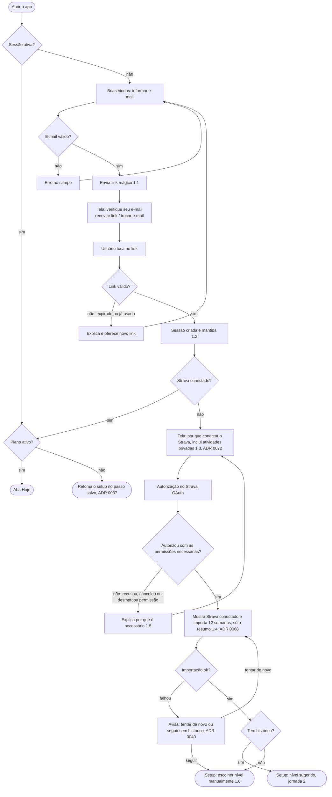

Regras de segurança da jornada: cada usuário só vê os próprios dados (RLS, 1.7), e os tokens do Strava ficam só no backend, em schema privado (ADR 0074). O app não guarda mapa nem GPS (ADR 0072).

## Jornada 2: setup do plano

Fluxo linear, uma pergunta por tela, com barra de progresso e botão de voltar (ADR 0037). As sugestões de nível e de pace vêm do motor de regras, nunca da IA (ADR 0066). O plano é gerado só com as respostas do setup.

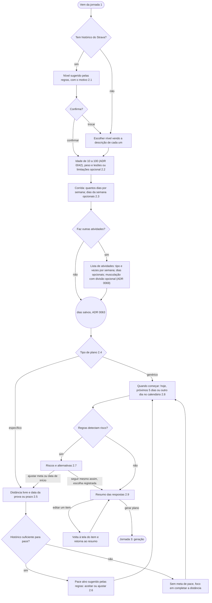

## Jornada 3: geração do plano

Segue o fluxo "IA propõe, regras validam" (ADR 0022) e o detalhe progressivo (ADR 0023). Ainda dentro do fluxo linear, sem a barra de abas (ADR 0037).

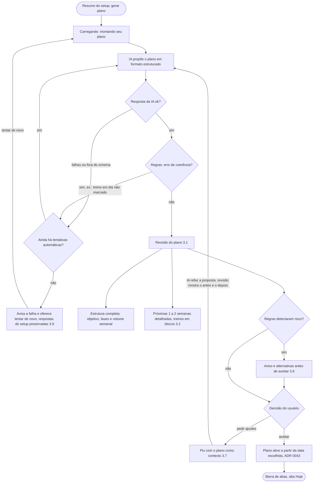

Depois do aceite, as semanas seguintes são detalhadas automaticamente na rotina das 22h do último dia de cada semana do plano (ADR 0044), e cada uma gera um resumo em Notificações (3.8).

## Jornada 4: dia a dia

Três fluxos: a sincronização com o Strava, as marcações feitas pelo usuário e a rotina das 22h. Todo ajuste automático desta jornada é feito **só pelo motor de regras**, sem IA (ADRs 0066 e 0067), entra direto no plano e chega a Notificações com o antes e o depois, em texto de template. Só o ajuste mais recente pode ser desfeito (ADR 0047, 4.9). Carga = intensidade do tipo × tempo em movimento, ou nota de esforço × tempo quando o usuário der a nota (ADR 0070).

### Sincronização e treino feito

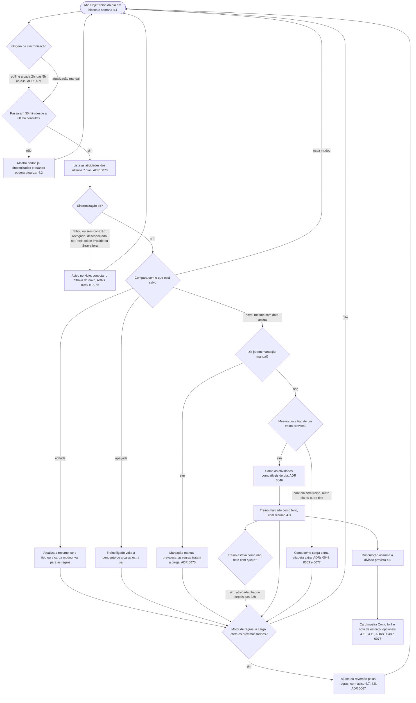

### Marcações do usuário

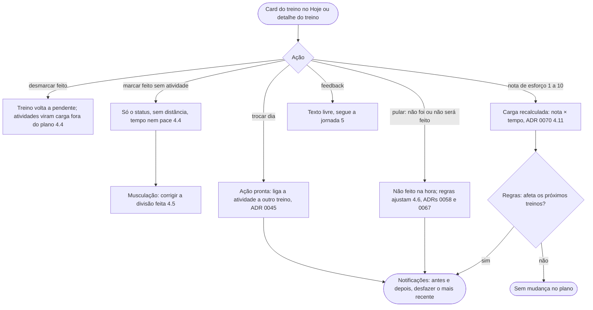

### Rotina das 22h, no fuso do usuário

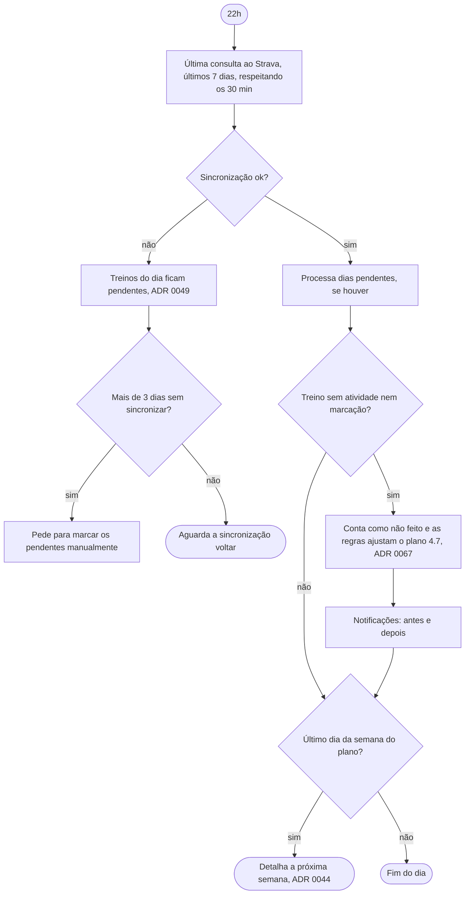

## Jornada 5: feedback e Notificações

Todas as mensagens em Notificações saem assinadas pelo Piu (ADR 0050). Nos ajustes disparados pelo Strava, o texto é de template e o Piu recebe só o antes e o depois do plano, nunca o motivo (ADRs 0066 e 0080). Dor ou lesão segue o mesmo tratamento dos outros feedbacks (ADR 0051, 5.6).

### Feedback

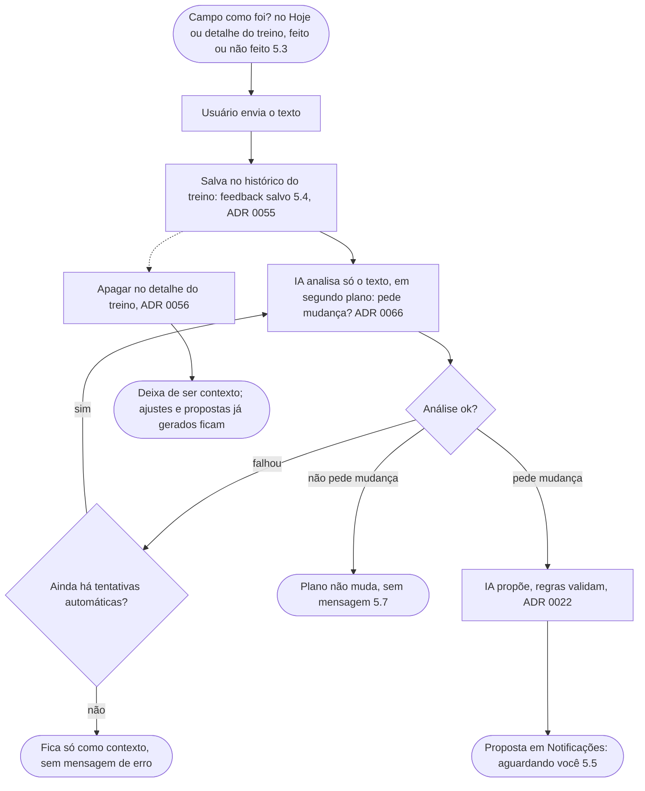

### Notificações

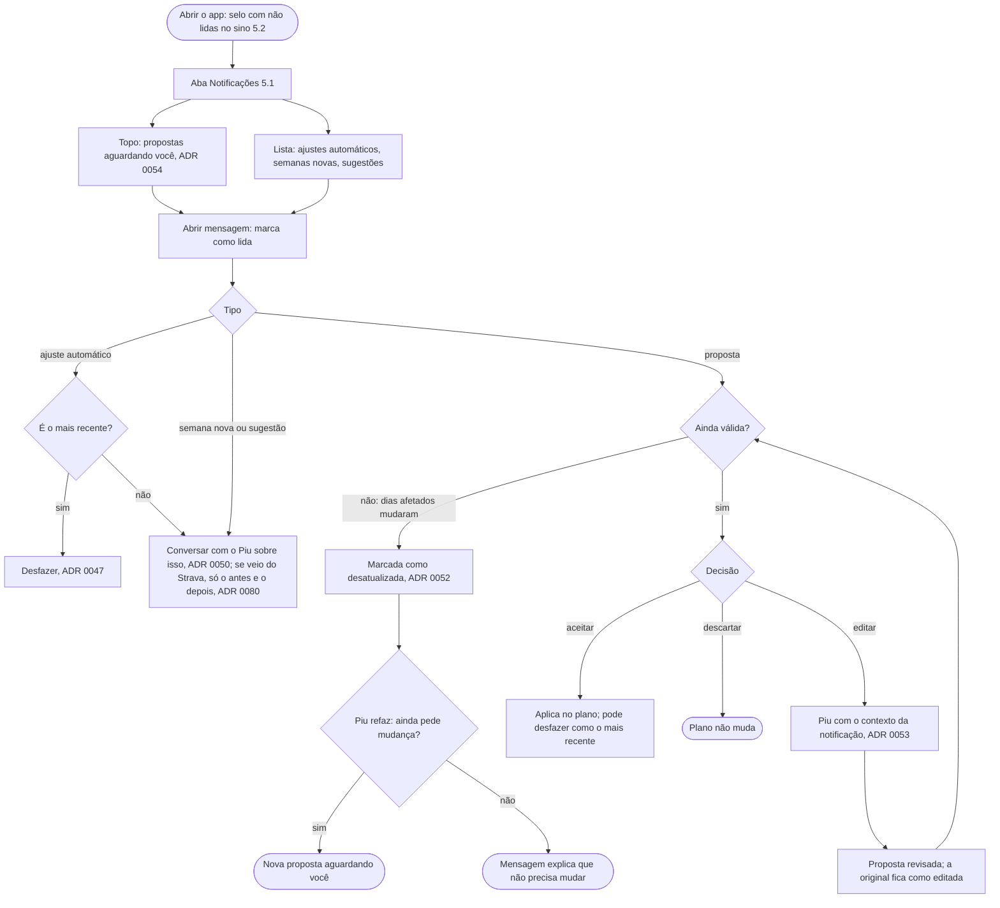

## Jornada 6: replanejamento

Treinos passados nunca são alterados (6.6). A única exceção é "trocar dia" para um dia passado com atividade ainda não ligada, que só registra o que já aconteceu (ADR 0057). Riscos geram aviso e alternativas, sem bloqueio (ADR 0017, 6.4). Só o ajuste mais recente pode ser desfeito (ADR 0047).

### Ações prontas

```mermaid
flowchart TD
  A([Card do Hoje, detalhe do treino ou cabeçalho da semana 6.1]) --> B{Ação pronta}
  B -- pular --> P[Treino vira não feito na hora, ADR 0058]
  P --> P1[Regras ajustam os próximos dias, sem IA, ADR 0067] --> N
  B -- trocar dia --> T[Escolhe dia da semana atual do plano, ADR 0057]
  T --> T1{Destino}
  T1 -- futuro ou hoje, sem treino da modalidade --> T2[Muda de dia]
  T1 -- futuro ou hoje, com treino da modalidade --> T3[Os dois trocam de lugar]
  T1 -- passado com atividade não ligada --> T4[Liga a atividade e marca feito]
  T1 -- passado sem atividade --> T5[Indisponível]
  T2 --> R
  T3 --> R
  T4 --> N
  B -- semana mais leve --> L[Reduz a corrida de hoje em diante; intensos viram leves, ADR 0059] --> R
  B -- adiar a prova, só plano específico --> AD[Escolhe data mais tarde; regras esticam a estrutura, ADR 0060] --> R
  R{Regras detectam risco?}
  R -- sim --> R1[Aviso e alternativas, sem bloqueio 6.4] --> N
  R -- não --> N
  N([Aplicado na hora: mostra o que mudou e permite desfazer 6.2])
```

### Conversa livre com o Piu

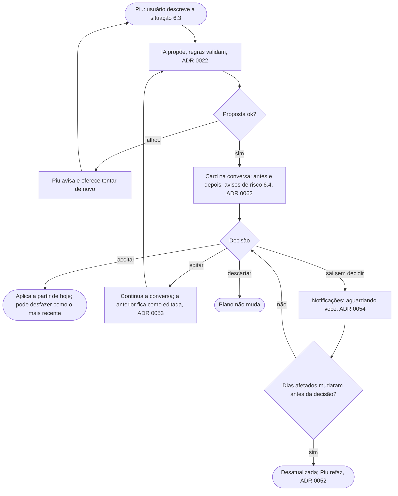

### Mudança nos dados do setup

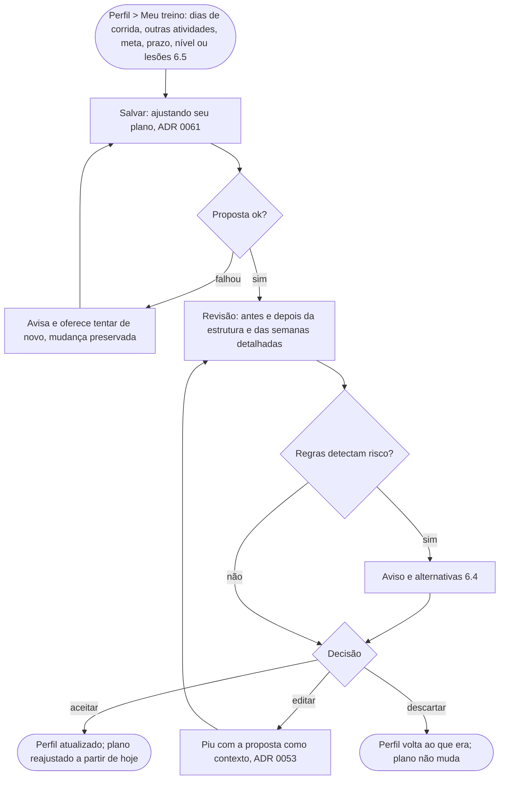
