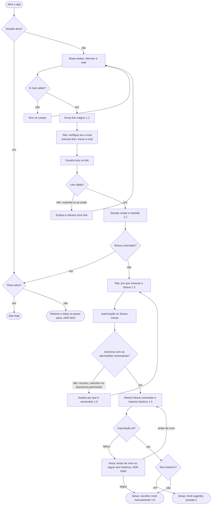

# Fluxos das jornadas (épico #2, card 3)

As 6 jornadas validadas em [`concepcao.md`](concepcao.md), desenhadas passo a passo, com os caminhos de erro. A navegação segue os ADRs 0034 a 0038. Os números entre parênteses apontam os critérios de aceitação (ex.: 1.3 é o critério 3 da jornada 1).

## Jornada 1: onboarding

Regras de segurança da jornada: cada usuário só vê os próprios dados (RLS, 1.7), e os tokens do Strava ficam só no backend.
